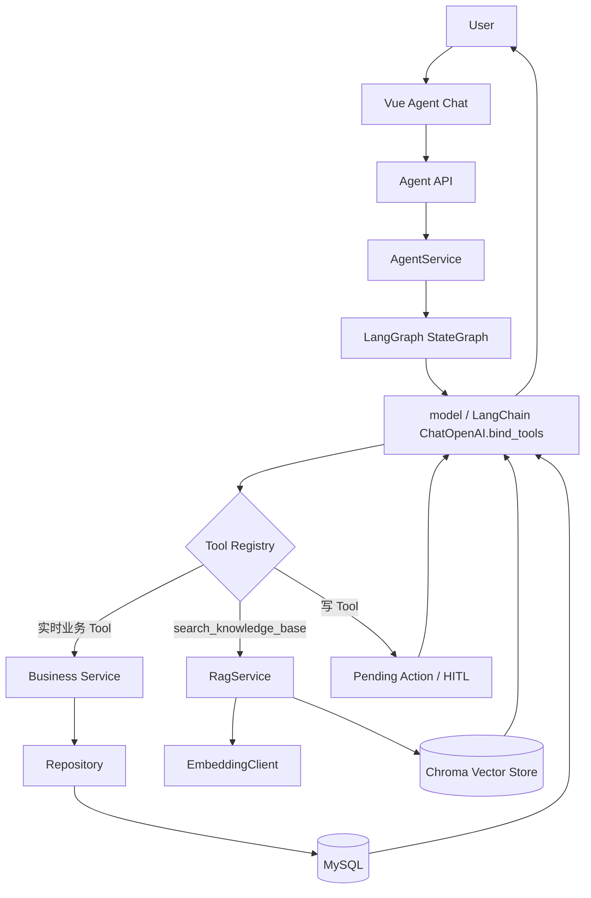

# Agent Phase 3：RAG 企业知识库设计

> 实现状态以 [RAG 混合检索技术文档](RAG_HYBRID_RETRIEVAL.md) 和 [RAG 混合检索验收](RAG_HYBRID_ACCEPTANCE.md) 为准。本文件早期章节描述 Chroma 单路及旧版重建行为，已由版本化 BM25/Chroma/RRF 实现取代，不应作为当前运行命令或索引操作依据。

## 1. 为什么需要 RAG

现有 Agent 的业务 Tool 适合查询配送需求、车辆出勤和派车方案等实时结构化数据，但不适合承载物流制度和操作手册。RAG 将企业文档作为可检索知识接入同一个 Agent，避免把实时数据复制到向量库。当前分类与温控业务已停用，历史文档不能被解释为仍有冷链派车限制。知识文档是系统操作与当前业务规则说明，不代表法律或行业强制规范。

## 2. Tool Calling 与 RAG

- Tool Calling：通过现有 Service/Repository 查询 MySQL 中的实时业务事实。
- RAG：通过 `search_knowledge_base` 检索企业知识文档 Chunk。
- 写操作：继续生成 Pending Action，只有人工确认后才调用原业务 Service。

## 3. 整体架构



RAG 没有独立聊天入口，而是现有 Agent tools 节点中的只读 StructuredTool。写操作经 approval / interrupt 和 execute 恢复路径，不能直接沿只读路径执行。

## 4. 知识入库流程

```text
backend/knowledge_base/*.md|*.txt
→ KnowledgeDocumentLoader
→ 文本清理与 Markdown 章节识别
→ KnowledgeTextSplitter
→ OpenAICompatibleEmbeddingClient
→ ChromaVectorStore
```

构建命令：

```bash
cd backend
python -m app.scripts.build_knowledge_base
```

命令会重建指定 Collection 并输出文档数与 Chunk 数。服务启动时不会自动重复 Embedding。

## 5. 查询流程

`RagService.search(query, top_k, document_type)` 先生成查询向量，再调用 Chroma 相似度检索。结果包含正文、来源文件、文档类型、章节、Chunk 序号和 0～1 的相似度分数。Chroma 使用 cosine distance，系统以 `1 - distance` 转换为 score。

## 6. search_knowledge_base Tool

参数包括 `query`、1～10 的 `top_k` 和可选的 `document_type`。Tool 返回真实来源。实时配送需求、车辆出勤和派车方案必须使用原业务 Tool，不得使用知识库替代。

## 7. Metadata

每个 Chunk 保存：

```text
source
document_name
document_type
section
chunk_index
```

当前文档类型包括 `dispatch_rule`、`cold_chain`、`cargo_rule`、`exception_manual`；其他 Markdown/TXT 默认为 `system_manual`。

## 8. 安全设计

- API Key 仅通过 `RAG_EMBEDDING_API_KEY` 环境变量读取。
- 文档和 Tool 结果均作为不可信参考数据，不能覆盖 System Prompt。
- 文档内容不能修改 RBAC、跳过 Service 校验或跳过 HITL。
- 知识 Tool 是只读 Tool，不能直接触发写操作。
- Provider 错误不会把响应正文、密钥或 traceback 暴露给前端。

## 9. HITL 如何保持

`move_delivery_demand` 和 `cancel_dispatch_plan` 仍标记为 `requires_confirmation=True`。即使模型先检索 RAG，后续写调用也只创建 Pending Action；确认、取消、过期和执行流程均沿用原实现。

## 10. Demo 示例

### 纯 RAG

```text
派车方案发布前需要检查哪些业务约束？
```

预期调用 `search_knowledge_base`，来源为 `dispatch_rules.md`。这是待现场验证的输入，不保证模型每次都选择同一个工具。

### 纯业务 Tool

```text
查看今天有哪些配送需求没有分配。
```

预期调用配送需求或方案业务 Tool，数据来自 MySQL，不调用 RAG。

### Tool + RAG

```text
请查询指定草稿方案的未分配需求，再根据知识库解释发布前需要检查哪些约束。
```

预期同时查询方案/需求实际数据和派车知识，最终回答明确区分“当前业务数据”和“知识库规则”；方案 ID 必须选用现场真实记录。

## 11. 配置

```env
RAG_EMBEDDING_PROVIDER=openai-compatible
RAG_EMBEDDING_MODEL=
RAG_EMBEDDING_API_KEY=
RAG_EMBEDDING_BASE_URL=
RAG_EMBEDDING_TIMEOUT=30
RAG_KNOWLEDGE_BASE_DIR=knowledge_base
RAG_VECTOR_STORE_DIR=rag_data/chroma
RAG_COLLECTION_NAME=logistics_knowledge
RAG_CHUNK_SIZE=800
RAG_CHUNK_OVERLAP=120
RAG_DEFAULT_TOP_K=4
```

Docker 使用 `rag_data` named volume 持久化 Chroma。真实密钥不得提交到 Git。

## 12. 当前边界

- 第一版只支持 UTF-8 Markdown 和 TXT，不支持 PDF。
- 第一版没有 reranker 和增量更新；知识变更后全量重建 collection。
- 第一版使用单机 Chroma 持久化目录，不提供分布式向量服务。
- Embedding 接口要求兼容 OpenAI `/embeddings` 协议。
- 知识更新后需要显式重新运行构建命令。
- 向量库只保存非结构化知识，不保存实时配送状态。

## 13. 原稳定 Tag 的历史验证记录

- Real Embedding：PASS；
- 知识文档：4；
- Chunks：19；
- Chroma 持久化及 Backend 容器重启后读取：PASS；
- Retriever、纯 RAG、纯业务 Tool、混合 Tool：PASS；
- Pending Action / HITL 回归：PASS；
- Vue Agent 页面端到端：PASS。

该记录仅属于原稳定版，不能证明升级分支验收。升级分支前一阶段重建为 4 文档 / 18 片段；本轮 Vue 已实际显示知识库来源和混合工具回答。真实无关问题仍返回 4 个邻近片段，但本次 Agent 正确说明未找到足够信息；这不代表一般性语义拒答保证。

## 15. 数据模型与版本关系（当前实现，权威）

> 本节描述的是版本化混合检索实现，**取代第 4、5、12 节的单路 Chroma 描述**。第 12 节「没有 reranker 和增量更新」的表述已过时。

### 15.1 四层实体

| 实体 | 载体 | 主键 | 生命周期 |
|---|---|---|---|
| 知识文档 | 文件系统 `knowledge_base/*.md\|*.txt` | 文件名 = `source` | 人工增删改，系统不写入 |
| Chunk | 只存在于 manifest JSON + Chroma metadata | `chunk_id`（内容派生哈希） | 每次重建重新生成 |
| 索引版本 | `rag_data/chroma/hybrid/<collection>/<version>.json` | 32 位 hex `version` | 只增不删，可回滚 |
| 活动指针 | 同目录 `active.json` | 唯一 | 原子替换，指向当前版本 |

### 15.2 关系

```mermaid
flowchart LR
    D[知识文档 *.md] -->|Loader 识别章节| S[KnowledgeSection]
    S -->|Splitter chunk_size/overlap| C[KnowledgeChunk<br/>chunk_id = sha256(内容+元数据)]
    C -->|Embedding 模型| V[向量]
    C -->|BM25 分词 jieba-search-v2| L[词法倒排]
    V --> X[(Chroma collection<br/>版本独占)]
    C --> M[manifest<br/>dataset_sha256]
    X --> M
    M --> P[active.json<br/>原子指针]
```

一个索引版本 = 一份 manifest（全量 Chunk + 配置 + 三个指纹）+ 一个独占 Chroma collection。
配置或数据任一变化都必须发布新版本，**不允许原地修改**。

### 15.3 `chunk_id` 生成规则

```
chunk_id = sha256(json({
  content, source, document_name, document_type,
  section, chunk_index, access_scope, document_id,
  index_version: null
}, sort_keys=True))
```

计算时机很关键：`rebuild()` 在 `publish()` 绑定版本号**之前**生成 `chunk_id`，因此该字段参与哈希时恒为 `null`。

关键性质：

* **与 `index_version` 实际取值无关** → 已实测两次独立重建（版本 `ede21797…` 与 `ef007d3e…`）得到完全相同的 18 个 `chunk_id`。注意：直接用已绑定版本的 Chunk 重新计算哈希会得到不同结果，不能作为校验方式。
* **不含 `chunk_id` 自身** → 由内容派生，不存在自引用。
* **包含 `section` 与 `chunk_index`** → 文档改名（`source` 变）或切分参数变化（`chunk_index` 变）都会产生新 ID，属于预期行为。

### 15.4 版本清单字段

| 字段 | 作用 |
|---|---|
| `version` | 版本标识，同时写入每个 Chunk 的 `index_version` |
| `configuration` | `chunk_size`/`chunk_overlap`/`tokenizer`/`lexical_policy`/`dictionary`/`embedding_model`/`embedding_provider`/`embedding_endpoint_sha256` |
| `dataset_sha256` | 全部 Chunk 序列化后的指纹 |
| `embedding_dimension` | 向量维度，检索时校验 |
| `embedding_sha256` | 全部向量的指纹，防止向量与清单错配 |
| `manifest_schema` = 2 | 清单结构版本 |
| `status` = `validated` | 只有校验通过的版本才可被读取 |

### 15.5 一致性约束（检索时强制）

1. `configuration` 与当前进程配置不一致 → 抛 `KnowledgeBaseNotReadyError`，拒绝检索（不静默降级）。
2. Chroma 中 ids/documents/metadatas/embeddings 数量与内容必须与 manifest 逐条一致。
3. 向量维度必须唯一且等于 `embedding_dimension`；向量指纹必须等于 `embedding_sha256`。
4. 每次检索前后都按 `access_scope` / `document_type` 重新过滤，融合与精排都不能绕过。

### 15.6 激活与回滚语义

* `publish(activate=True)`：构建新 collection → 校验 → 写 `<version>.json` → 原子替换 `active.json`。
* `activate(version, expected_active_version)`：CAS 式切换，活动版本已变则拒绝，避免并发覆盖。
* 回滚 = 把 `active.json` 指回旧版本；旧 collection 永不删除，因此回滚不需要重建。
* 构建期间持 `build.lock`（`O_EXCL`），并发构建直接失败，不会产生半成品指针。

### 15.7 与评测的对应关系

评测只读同一份 manifest：`dataset_sha256` 保证「被评测的 Chunk 集合」可复现，`version` 保证「被评测的索引」可追溯。
`backend/tools/evaluate_rag_suite.py` 与 `app/rag/evaluation.py` 使用同一套指标函数，管理后台的评测中心复用同一实现，避免 CLI 与页面出现两个口径。


## 14. 无匹配与置信度边界

score 是由余弦距离转换并限制到 0～1 的数值，不是答案正确率。当前没有相似度阈值或语义拒答器：无关问题仍可能获得 top-k 邻近片段。空 collection / 类型过滤无结果时 Tool 返回“知识库未找到足够的相关信息”，但这不能替代真实无关问题验收。不要声称 RAG 已保证所有无匹配问题拒答。最新验收见[最终报告](../GITHUB_RELEASE_FINAL_REPORT.md)。
