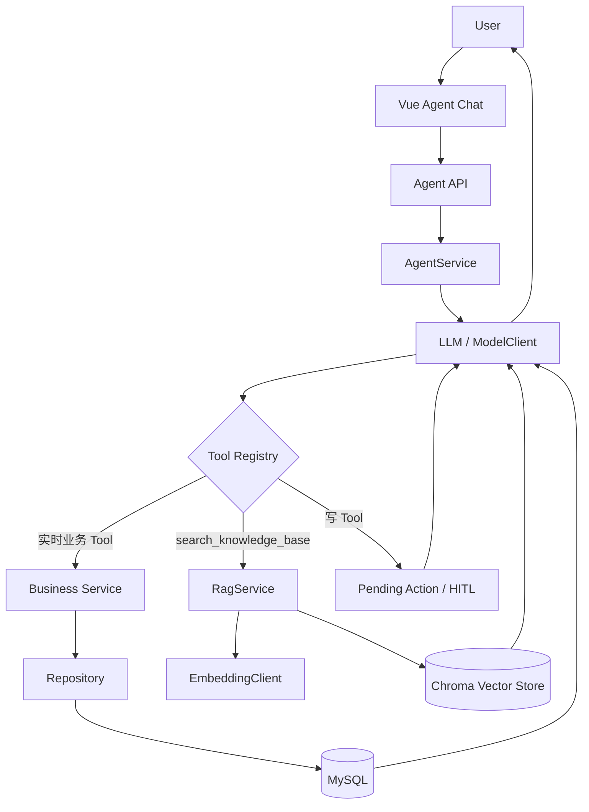

# Agent Phase 3：RAG 企业知识库设计

## 1. 为什么需要 RAG

现有 Agent 的业务 Tool 适合查询配送需求、车辆出勤和派车方案等实时结构化数据，但不适合承载物流制度、冷链要求和操作手册。RAG 将企业文档作为可检索知识接入同一个 Agent，避免把实时数据复制到向量库，也避免模型凭自身知识猜测项目规则。当前示例知识仅用于 Demo，不代表法律或行业强制规范。

## 2. Tool Calling 与 RAG

- Tool Calling：通过现有 Service/Repository 查询 MySQL 中的实时业务事实。
- RAG：通过 `search_knowledge_base` 检索企业知识文档 Chunk。
- 写操作：继续生成 Pending Action，只有人工确认后才调用原业务 Service。

## 3. 整体架构



RAG 没有独立聊天入口，而是现有 Agent 的一个只读 Tool。

## 4. 知识入库流程

```text
backend/knowledge_base/*.md|*.txt
→ KnowledgeDocumentLoader
→ 文本清理与 Markdown 章节识别
→ KnowledgeTextSplitter
→ OpenAICompatibleEmbeddingClient
→ ChromaVectorStore
```

构建命令：

```bash
cd backend
python -m app.scripts.build_knowledge_base
```

命令会重建指定 Collection 并输出文档数与 Chunk 数。服务启动时不会自动重复 Embedding。

## 5. 查询流程

`RagService.search(query, top_k, document_type)` 先生成查询向量，再调用 Chroma 相似度检索。结果包含正文、来源文件、文档类型、章节、Chunk 序号和 0～1 的相似度分数。Chroma 使用 cosine distance，系统以 `1 - distance` 转换为 score。

## 6. search_knowledge_base Tool

参数包括 `query`、1～10 的 `top_k` 和可选的 `document_type`。Tool 返回真实来源。实时配送需求、车辆出勤和派车方案必须使用原业务 Tool，不得使用知识库替代。

## 7. Metadata

每个 Chunk 保存：

```text
source
document_name
document_type
section
chunk_index
```

当前文档类型包括 `dispatch_rule`、`cold_chain`、`cargo_rule`、`exception_manual`；其他 Markdown/TXT 默认为 `system_manual`。

## 8. 安全设计

- API Key 仅通过 `RAG_EMBEDDING_API_KEY` 环境变量读取。
- 文档和 Tool 结果均作为不可信参考数据，不能覆盖 System Prompt。
- 文档内容不能修改 RBAC、跳过 Service 校验或跳过 HITL。
- 知识 Tool 是只读 Tool，不能直接触发写操作。
- Provider 错误不会把响应正文、密钥或 traceback 暴露给前端。

## 9. HITL 如何保持

`move_delivery_demand` 和 `cancel_dispatch_plan` 仍标记为 `requires_confirmation=True`。即使模型先检索 RAG，后续写调用也只创建 Pending Action；确认、取消、过期和执行流程均沿用原实现。

## 10. Demo 示例

### 纯 RAG

```text
冷冻货物对车辆有什么要求？
```

预期调用 `search_knowledge_base`，来源为 `cold_chain_rules.md` 或 `cargo_transport_rules.md`。

### 纯业务 Tool

```text
查看今天有哪些配送需求没有分配。
```

预期调用配送需求或方案业务 Tool，数据来自 MySQL，不调用 RAG。

### Tool + RAG

```text
为什么这个冷冻配送需求不能分配给当前车辆？
```

预期同时查询方案/需求实际数据和冷链知识，最终回答明确区分“当前业务数据”和“知识库规则”。

## 11. 配置

```env
RAG_EMBEDDING_PROVIDER=openai-compatible
RAG_EMBEDDING_MODEL=
RAG_EMBEDDING_API_KEY=
RAG_EMBEDDING_BASE_URL=
RAG_EMBEDDING_TIMEOUT=30
RAG_KNOWLEDGE_BASE_DIR=knowledge_base
RAG_VECTOR_STORE_DIR=rag_data/chroma
RAG_COLLECTION_NAME=logistics_knowledge
RAG_CHUNK_SIZE=800
RAG_CHUNK_OVERLAP=120
RAG_DEFAULT_TOP_K=4
```

Docker 使用 `rag_data` named volume 持久化 Chroma。真实密钥不得提交到 Git。

## 12. 当前边界

- 第一版只支持 UTF-8 Markdown 和 TXT，不支持 PDF。
- 第一版没有 reranker 和增量更新；知识变更后全量重建 collection。
- 第一版使用单机 Chroma 持久化目录，不提供分布式向量服务。
- Embedding 接口要求兼容 OpenAI `/embeddings` 协议。
- 知识更新后需要显式重新运行构建命令。
- 向量库只保存非结构化知识，不保存实时配送状态。

## 13. 稳定版验证记录

- Real Embedding：PASS；
- 知识文档：4；
- Chunks：19；
- Chroma 持久化及 Backend 容器重启后读取：PASS；
- Retriever、纯 RAG、纯业务 Tool、混合 Tool：PASS；
- Pending Action / HITL 回归：PASS；
- Vue Agent 页面端到端：PASS。

该记录表示既有真实环境验证已经完成；外部模型或 Embedding 配额不足时不伪造在线回答。
